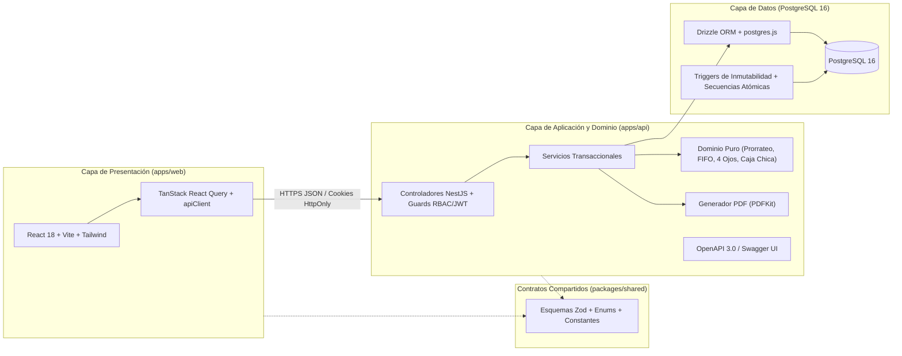
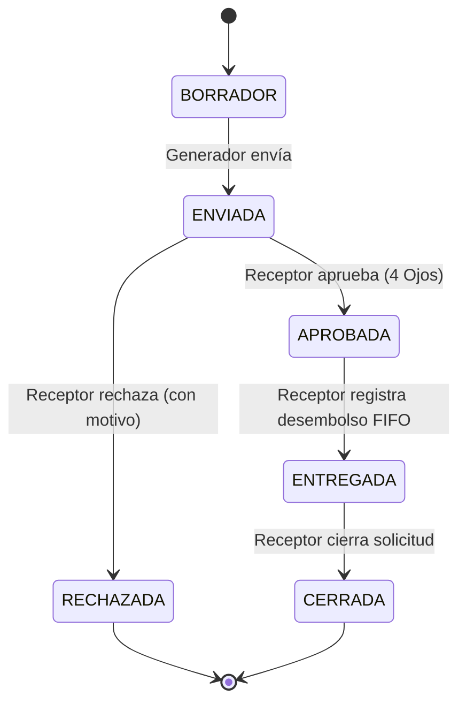

# 📘 Informe Técnico del Proyecto — Scienpay

**Sistema de Control de Pagos y Asignaciones Científicas**  
**Institución:** Universidad de Carabobo — Facultad Experimental de Ciencias y Tecnología (FACYT)  
**Asignatura:** Sistemas de Información  
**Fecha:** 18 de noviembre de 2026  
**Integrantes:** Angel Bandres, Andrés Crespo, Brayan Ceballos y Joshtin Mejias.

---

## 1. Resumen Ejecutivo

**Scienpay** es una plataforma web cliente-servidor diseñada para sustituir el control manual en hojas de cálculo por un sistema auditable, inmutable y con segregación estricta de funciones para gestionar pagos, asignaciones y cajas chicas en proyectos de investigación científica (Física, Química y Biología).

El sistema opera estrictamente en **dólares estadounidenses (USD)** sin deducciones fiscales, garantiza precisión financiera con aritmética decimal exacta (`NUMERIC(14,2)` + `decimal.js`), aplica amortización de pagos parciales bajo el algoritmo **FIFO**, y protege todos los registros financieros y la bitácora de auditoría mediante **triggers a nivel de base de datos**.

### Métricas Globales del Proyecto

| Indicador | Valor |
|---|---|
| **Arquitectura** | Monorepo npm workspaces (`@scienpay/shared`, `@scienpay/api`, `@scienpay/web`) |
| **Código fuente propio** | ~14,250 líneas de TypeScript / TSX |
| **Módulos de negocio (Backend)** | 10 módulos NestJS + 10 motores/políticas de dominio puro |
| **Esquema de Base de Datos** | 18 tablas principales + 3 tablas de secuencias transaccionales (5 migraciones SQL) |
| **Contratos API (OpenAPI 3.0.3)** | 43 endpoints REST documentados + 21 esquemas Zod |
| **Interfaz Web (SPA)** | 3 vistas por rol, 9 formularios validados, 10 hooks React Query, diseño *mobile-first* |
| **Cobertura de pruebas** | 98 tests Backend + 10 tests Frontend + 6 suites Integración PG16 + 6 pruebas E2E Playwright |
| **Decisiones documentadas** | 8 ADRs ([ADR-001](file:///c:/Users/andre/Desktop/Proyecto%20Final%20SI/scienpay-software/docs/decisiones/ADR-001-stack-monorepo.md) a [ADR-008](file:///c:/Users/andre/Desktop/Proyecto%20Final%20SI/scienpay-software/docs/decisiones/ADR-008-calidad-y-ci.md)) |

---

## 2. Arquitectura del Sistema

El proyecto implementa una **Arquitectura Limpia (Clean Architecture) orientada al dominio** dentro de un monorepo, separando estrictamente las reglas financieras puras de la infraestructura HTTP, la persistencia SQL y la interfaz de usuario.



### Estructura del Monorepo

```text
scienpay-software/
├── api/                         # Entrypoints Vercel Serverless (index.mjs, [...path].mjs)
├── apps/
│   ├── api/                     # Backend NestJS 10 + Drizzle ORM + PDFKit + OpenAPI
│   │   ├── src/domain/          # Reglas financieras y de seguridad sin dependencias externas
│   │   ├── src/infrastructure/  # Auth (JWT/Argon2id), BD (migraciones/seed), PDF, OpenAPI, Zod
│   │   ├── src/modules/         # 10 módulos funcionales (controllers + services)
│   │   └── test/                # Suites domain/, foundation/ e integration/
│   └── web/                     # Frontend SPA React 18 + Vite 5 + Tailwind CSS
│       ├── src/components/      # Views (Admin, Generador, Receptor), Forms (9), Modals, UI
│       ├── src/context/         # AuthContext (JWT en memoria), ThemeContext, ToastContext
│       ├── src/hooks/           # 10 hooks React Query conectados a la API real
│       └── e2e/                 # Pruebas E2E Playwright (auth.spec.ts, roles.spec.ts)
├── packages/shared/             # Contratos Zod, enums y constantes compartidos
├── docker/nginx/                # Proxy inverso Nginx para despliegue en contenedores
├── docs/                        # ADRs (001-008), HANDOFF, bitácoras de IA y avances
├── scripts/                     # Backups/restore multiplataforma y vercel-runner.mjs
├── Dockerfile                   # Build multi-stage de producción
├── docker-compose.yml           # Orquestación local/VPS (db, api, web, proxy)
└── vercel.json                  # Despliegue serverless + SPA + headers de seguridad
```

---

## 3. Stack Tecnológico

| Capa | Tecnología | Propósito Principal |
|---|---|---|
| **Lenguaje** | TypeScript 5.6 (`strict: true`) | Tipado estricto de extremo a extremo |
| **Backend** | NestJS 10 + Express 4 | API REST modular, inyección de dependencias, Guards y Pipes |
| **Base de Datos** | PostgreSQL 16 + Drizzle ORM 0.33 | Persistencia relacional, transacciones ACID, triggers PL/pgSQL |
| **Aritmética Financiera** | `decimal.js` 10.4 | Cálculos exactos en USD sin errores de punto flotante binario |
| **Validación y Contratos** | Zod 3.23 + `@asteasolutions/zod-to-openapi` | Validación compartida y generación automática de OpenAPI 3.0.3 |
| **Documentos PDF** | PDFKit 0.20 | Recibos individuales y solicitudes consolidadas en PDF |
| **Seguridad** | Argon2id (`argon2`), JWT (`jsonwebtoken`), Helmet, `cookie-parser` | Hashing resistente a GPU, tokens cortos, refresh rotativos y CSP |
| **Frontend** | React 18 + Vite 5 + Tailwind CSS 3 | SPA responsiva *mobile-first* con tema claro/oscuro/sistema |
| **Estado y Formularios** | TanStack React Query 5 + React Hook Form 7 | Caché sincronizada con API, invalidación automática y validación Zod |
| **Calidad y Testing** | Node Test Runner (`tsx`), Vitest 2, RTL, Playwright, ESLint 9, Prettier 3 | Pruebas unitarias, integración, E2E y puertas de CI |

---

## 4. Diseño de Base de Datos e Inmutabilidad

El esquema ([schema.ts](file:///c:/Users/andre/Desktop/Proyecto%20Final%20SI/scienpay-software/apps/api/src/infrastructure/database/schema.ts)) consta de **18 tablas de negocio** y **3 tablas de secuencias transaccionales**, gestionadas mediante **5 migraciones SQL idempotentes**:

| Migración | Responsabilidad |
|---|---|
| [0001_initial_schema_and_triggers.sql](file:///c:/Users/andre/Desktop/Proyecto%20Final%20SI/scienpay-software/apps/api/src/infrastructure/database/migrations/0001_initial_schema_and_triggers.sql) | Creación de las 18 tablas, llaves foráneas `RESTRICT`/`CASCADE`, restricción `chk_four_eyes_approval` y triggers iniciales de inmutabilidad. |
| [0002_fix_causation_immutability_and_receipt_sequences.sql](file:///c:/Users/andre/Desktop/Proyecto%20Final%20SI/scienpay-software/apps/api/src/infrastructure/database/migrations/0002_fix_causation_immutability_and_receipt_sequences.sql) | Inmutabilidad a nivel de columna en `causation_items` (permite actualizar únicamente `paid_amount`, `remaining_debt` y `status`) y `causation_batches` (solo campos de anulación). Introduce `receipt_sequences` + `next_receipt_number(year)` transaccional sin saltos. |
| [0003_petty_cash_voucher_sequences.sql](file:///c:/Users/andre/Desktop/Proyecto%20Final%20SI/scienpay-software/apps/api/src/infrastructure/database/migrations/0003_petty_cash_voucher_sequences.sql) | Secuencia transaccional `voucher_sequences` + `next_voucher_number(year)` (`VAL-YYYY-NNNN`) e índice único parcial de idempotencia en `causation_batches` (`WHERE status <> 'ANULADO'`). |
| [0004_user_deactivation_and_audit_indexes.sql](file:///c:/Users/andre/Desktop/Proyecto%20Final%20SI/scienpay-software/apps/api/src/infrastructure/database/migrations/0004_user_deactivation_and_audit_indexes.sql) | Baja lógica de usuarios (`is_active`, `deactivated_at`) e índices compuestos sobre `audit_log` para consultas paginadas y filtradas. |
| [0005_request_sequences_and_notes.sql](file:///c:/Users/andre/Desktop/Proyecto%20Final%20SI/scienpay-software/apps/api/src/infrastructure/database/migrations/0005_request_sequences_and_notes.sql) | Secuencia transaccional `request_sequences` + `next_request_number(year)` (`SOL-YYYY-NNN`) y columna `notes` en `payment_requests`. |

### Garantías de Integridad en PostgreSQL

1. **Inmutabilidad Financiera ([ADR-003](file:///c:/Users/andre/Desktop/Proyecto%20Final%20SI/scienpay-software/docs/decisiones/ADR-003-inmutabilidad-financiera-triggers-secuencias.md)):** Triggers `BEFORE UPDATE OR DELETE` bloquean con excepción fatal cualquier alteración sobre `disbursements`, `receipts`, `receipt_allocations`, `petty_cash_movements` y `audit_log`.
2. **Secuencias sin Huecos:** Los correlativos `SOL-YYYY-NNN`, `REC-YYYY-NNNNNN` y `VAL-YYYY-NNNN` se generan con tablas contador dentro de la misma transacción SQL; si una operación falla y hace `ROLLBACK`, el contador no se desperdicia.
3. **Bloqueo Pesimista (`SELECT ... FOR UPDATE`):** Evita condiciones de carrera al aplicar pagos FIFO concurrentes o desembolsar vales de caja chica sobre el mismo saldo.

---

## 5. Motores de Dominio y Lógica Financiera

Toda la lógica crítica reside en clases puras y deterministas en `apps/api/src/domain/`:

### 5.1. Prevención de Solapamiento de Asignaciones
* **Archivo:** [assignment-overlap.policy.ts](file:///c:/Users/andre/Desktop/Proyecto%20Final%20SI/scienpay-software/apps/api/src/domain/assignments/assignment-overlap.policy.ts)
* Impide que una misma persona tenga dos asignaciones activas simultáneas en el mismo proyecto evaluando la intersección inclusiva de fechas: $\max(A_{\text{inicio}}, B_{\text{inicio}}) \le \min(A_{\text{fin}}, B_{\text{fin}})$.

### 5.2. Motor de Causación y Prorrateo ([ADR-004](file:///c:/Users/andre/Desktop/Proyecto%20Final%20SI/scienpay-software/docs/decisiones/ADR-004-algoritmo-prorrateo-causacion.md))
* **Archivo:** [causation-calculator.ts](file:///c:/Users/andre/Desktop/Proyecto%20Final%20SI/scienpay-software/apps/api/src/domain/causation/causation-calculator.ts)
* Calcula el monto causado exacto por días calendario inclusivos con redondeo `ROUND_HALF_UP` a 2 decimales usando `Decimal.js`:

$$\text{monto\_causado} = \text{monto\_período} \times \frac{\text{días\_activos}}{\text{días\_período}}$$

* Soporta previsualización sin persistencia (`POST /causation/preview`), generación idempotente por lote (`POST /causation/generate`), cambios de monto a mitad de período (múltiples tramos) y anulación justificada (`POST /causation/batches/:id/annul`) gobernada por [causation-annulment.policy.ts](file:///c:/Users/andre/Desktop/Proyecto%20Final%20SI/scienpay-software/apps/api/src/domain/causation/causation-annulment.policy.ts).

### 5.3. Máquina de Estados de Solicitudes de Pago
* **Archivo:** [payment-request-state-machine.ts](file:///c:/Users/andre/Desktop/Proyecto%20Final%20SI/scienpay-software/apps/api/src/domain/payment-requests/payment-request-state-machine.ts)



### 5.4. Motor de Amortización FIFO ([ADR-005](file:///c:/Users/andre/Desktop/Proyecto%20Final%20SI/scienpay-software/docs/decisiones/ADR-005-algoritmo-pagos-parciales-fifo.md))
* **Archivo:** [fifo-allocation.engine.ts](file:///c:/Users/andre/Desktop/Proyecto%20Final%20SI/scienpay-software/apps/api/src/domain/payments/fifo-allocation.engine.ts)
* Ordena deterministamente las causaciones pendientes por `(period_start_date ASC, id ASC)`.
* Rechaza cualquier desembolso que supere la deuda acumulada total del beneficiario.
* Imputa pagos parciales o totales generando registros inmutables en `receipt_allocations`, recibos consecutivos en `receipts` y cuadratura exacta de `remaining_debt`.

### 5.5. Libro Mayor de Cajas Chicas
* **Archivo:** [petty-cash-ledger.engine.ts](file:///c:/Users/andre/Desktop/Proyecto%20Final%20SI/scienpay-software/apps/api/src/domain/petty-cash/petty-cash-ledger.engine.ts)
* Gestiona múltiples cajas chicas asignables N:M a proyectos, apertura mensual con **arrastre automático** del `closing_balance` del período anterior cerrado, solicitud/aprobación/desembolso de vales verificando liquidez, rendición con validación de cuadratura exacta ($\text{solicitado} = \text{rendido} + \text{vuelto}$), reintegro de vueltos y cierre mensual bloqueado si existen vales pendientes.

---

## 6. Seguridad, Segregación de Funciones y Auditoría

Diseñado bajo lineamientos **OWASP ASVS Nivel 2** ([ADR-006](file:///c:/Users/andre/Desktop/Proyecto%20Final%20SI/scienpay-software/docs/decisiones/ADR-006-seguridad-autenticacion-cuatro-ojos.md)):

| Control | Implementación Verificada |
|---|---|
| **Hashing de Contraseñas** | **Argon2id** (64 MB memoria, 3 iteraciones, paralelismo 4) en [password.service.ts](file:///c:/Users/andre/Desktop/Proyecto%20Final%20SI/scienpay-software/apps/api/src/domain/security/password.service.ts). |
| **Autenticación Híbrida** | Access Token JWT ($\le 15$ min) mantenido únicamente en memoria del cliente (nunca `localStorage`) + Refresh Token rotativo (7 días) en cookie `HttpOnly`, `SameSite`, almacenado con hash SHA-256 y `family_id` para revocación total ante *replay*. |
| **Anti-Fuerza Bruta** | [account-security.policy.ts](file:///c:/Users/andre/Desktop/Proyecto%20Final%20SI/scienpay-software/apps/api/src/domain/security/account-security.policy.ts) + [login-rate-limiter.ts](file:///c:/Users/andre/Desktop/Proyecto%20Final%20SI/scienpay-software/apps/api/src/infrastructure/auth/login-rate-limiter.ts): suspensión temporal de 5 min al 3er intento fallido y bloqueo definitivo al 4to intento (solo desbloqueable por `ADMIN`). |
| **RBAC Estricto** | `JwtAuthGuard` + `RolesGuard` + [role-permissions.policy.ts](file:///c:/Users/andre/Desktop/Proyecto%20Final%20SI/scienpay-software/apps/api/src/domain/security/role-permissions.policy.ts). Los beneficiarios (`persons`) **no poseen cuenta ni credenciales**. |
| **Regla de Cuatro Ojos** | Doble validación: en dominio (`creatorUserId !== reviewerUserId`) y en PostgreSQL (`CHECK (reviewed_by_user_id IS NULL OR created_by_user_id <> reviewed_by_user_id)`). |
| **Protección HTTP** | Helmet CSP, validación de UUID en parámetros (`UuidParam`), `ZodValidationPipe` + `ZodExceptionFilter`, CORS restringido a orígenes autorizados. |
| **Trazabilidad (`audit_log`)** | `AuditService.recordEvent()` conectado en **39 puntos** a lo largo de los **10 módulos** del sistema, registrando actor, rol, acción, entidad, `oldValues`, `newValues`, IP y timestamp UTC dentro de las transacciones. |

### Matriz de Segregación de Funciones

| Módulo / Operación | `ADMIN` | `GENERADOR` | `RECEPTOR` |
|---|:---:|:---:|:---:|
| Usuarios (Crear, Editar, Desactivar, Reactivar, Desbloquear) | ✅ | ❌ | ❌ |
| Parámetros del Sistema y Consulta de `audit_log` | ✅ | ❌ | ❌ |
| Proyectos, Beneficiarios, Grupos de Pago y Asignaciones | Lectura | ✅ CRUD | Lectura |
| Causación (Previsualizar, Generar Lote, Anular) | ❌ | ✅ | Lectura |
| Solicitudes de Pago (Crear y Enviar) | ❌ | ✅ | ❌ |
| Solicitudes de Pago (Aprobar/Rechazar 4 Ojos y Cerrar) | ❌ | ❌ | ✅ |
| Desembolsos FIFO y Recibos PDF | ❌ | ❌ | ✅ |
| Cajas Chicas (Crear, Abrir, Aprobar, Desembolsar, Rendir, Cerrar) | ❌ | Solicitar vales | ✅ Gestión total |

---

## 7. API REST, Documentación OpenAPI y Generación de PDFs

* **Prefijo global:** `/api/v1`
* **Documentación interactiva:** Swagger UI en `/api/docs` y especificación JSON en `/api/docs.json`, generados automáticamente desde los contratos Zod compartidos en [openapi.ts](file:///c:/Users/andre/Desktop/Proyecto%20Final%20SI/scienpay-software/apps/api/src/infrastructure/openapi/openapi.ts) (**43 rutas**, **21 esquemas**, seguridad `bearerAuth`).
* **Reportes PDF ([pdf-receipt.generator.ts](file:///c:/Users/andre/Desktop/Proyecto%20Final%20SI/scienpay-software/apps/api/src/infrastructure/pdf/pdf-receipt.generator.ts)):**
  1. **Recibo Individual (`GET /api/v1/disbursements/receipts/:id/pdf`):** Membrete institucional, correlativo `REC-YYYY-NNNNNN`, datos del beneficiario/proyecto, desglose tabular de imputaciones FIFO, saldo remanente y líneas de firma. Genera en el mismo documento el ejemplar Original (beneficiario) y la Copia de registro contable (empresa).
  2. **Solicitud Consolidada (`GET /api/v1/payment-requests/:id/pdf`):** Resumen consolidado del lote con tabla por beneficiario (causado, pagado, pendiente), totales globales y bloque de firmas (Generador, Receptor y Administración).

---

## 8. Frontend (Aplicación Web SPA)

Construida en `apps/web` sin datos simulados ([ADR-007](file:///c:/Users/andre/Desktop/Proyecto%20Final%20SI/scienpay-software/docs/decisiones/ADR-007-frontend-conectado-api.md)):

* **Comunicación HTTP ([apiClient.ts](file:///c:/Users/andre/Desktop/Proyecto%20Final%20SI/scienpay-software/apps/web/src/lib/apiClient.ts)):** Cliente `fetch` con inyección automática de Bearer token, renovación transparente ante `401` con deduplicación de promesas, normalización de errores (`ApiError`) y descarga binaria de PDFs.
* **Gestión de Sesión ([AuthContext.tsx](file:///c:/Users/andre/Desktop/Proyecto%20Final%20SI/scienpay-software/apps/web/src/context/AuthContext.tsx)):** Restauración automática al recargar vía `/auth/refresh` + `/auth/me`, renovación proactiva 60 segundos antes de expirar el JWT y confirmación de salida al navegar hacia atrás (`popstate`).
* **Vistas y Formularios:**
  * [AdminView.tsx](file:///c:/Users/andre/Desktop/Proyecto%20Final%20SI/scienpay-software/apps/web/src/components/Views/AdminView.tsx): CRUD completo de usuarios (crear, editar, desactivar, reactivar, desbloquear, resetear intentos), parámetros y visor de auditoría con filtros y paginación.
  * [GeneratorView.tsx](file:///c:/Users/andre/Desktop/Proyecto%20Final%20SI/scienpay-software/apps/web/src/components/Views/GeneratorView.tsx): Proyectos, beneficiarios, grupos de pago, asignaciones (con finalización justificada), motor de causación con previsualización/anulación y emisión/envío de solicitudes.
  * [ReceptorView.tsx](file:///c:/Users/andre/Desktop/Proyecto%20Final%20SI/scienpay-software/apps/web/src/components/Views/ReceptorView.tsx): Bandeja de aprobación (4 ojos), registro de desembolsos FIFO en centavos, recibos descargables en PDF y gestión integral de cajas chicas.
* **UX e Identidad Visual:** Diseño responsivo *mobile-first*, identidad institucional **Scienpay — Universidad de Carabobo - FACYT**, visualización predeterminada y exclusiva en Modo Claro (estándar administrativo) y acceso rápido 1-click para demostración.

---

## 9. Estrategia de Pruebas, Calidad y CI/CD

| Nivel de Prueba | Herramienta | Alcance y Resultado Verificado |
|---|---|---|
| **Unitarias y Fundación (API)** | `tsx --test` | **98 / 98 PASS** (19 archivos): prorrateo `HALF_UP`, solapamiento, FIFO determinista, máquina de estados, RBAC, 4 ojos, inmutabilidad SQL, PDFs, secuencias y contrato OpenAPI. |
| **Unitarias (Frontend)** | Vitest + Testing Library + jsdom | **10 / 10 PASS** (4 archivos): `apiClient`, `AuthContext`, `zodResolver` y `DisbursementForm`. |
| **Integración (API + PG16)** | `run-integration.mjs` + `docker-compose.test.yml` | **6 suites** (`auth`, `catalogs`, `security`, `financial-flow`, `petty-cash`, `fifo-concurrency`): flujo completo y estrés de **20 desembolsos concurrentes × 10 repeticiones** con cuadratura SQL exacta. |
| **End-to-End (Navegador)** | Playwright (Chromium) | **2 specs / 6 escenarios** ([auth.spec.ts](file:///c:/Users/andre/Desktop/Proyecto%20Final%20SI/scienpay-software/apps/web/e2e/auth.spec.ts), [roles.spec.ts](file:///c:/Users/andre/Desktop/Proyecto%20Final%20SI/scienpay-software/apps/web/e2e/roles.spec.ts)): login, persistencia de sesión, logout con confirmación y navegación por rol. |
| **Calidad Estática y CI** | GitHub Actions ([ci.yml](file:///c:/Users/andre/Desktop/Proyecto%20Final%20SI/scienpay-software/.github/workflows/ci.yml)) | Jobs bloqueantes `validate` (`format:check`, `lint`, `typecheck`, unit tests, `build`), `integration` (servicio PostgreSQL 16) y `security-scan` ([ADR-008](file:///c:/Users/andre/Desktop/Proyecto%20Final%20SI/scienpay-software/docs/decisiones/ADR-008-calidad-y-ci.md)). |

---

## 10. Despliegue e Infraestructura

El sistema está preparado para dos entornos de producción:

1. **Vercel Serverless + Postgres Cloud (Producción Principal):**
   * Configurado en [vercel.json](file:///c:/Users/andre/Desktop/Proyecto%20Final%20SI/scienpay-software/vercel.json) con build vía [vercel-runner.mjs](file:///c:/Users/andre/Desktop/Proyecto%20Final%20SI/scienpay-software/scripts/vercel-runner.mjs), SPA en `apps/web/dist`, rewrites de `/api/*` al handler serverless (`api/[...path].mjs` → [serverless.ts](file:///c:/Users/andre/Desktop/Proyecto%20Final%20SI/scienpay-software/apps/api/src/serverless.ts)) y cabeceras de seguridad (HSTS, `X-Frame-Options: DENY`, `nosniff`, caché inmutable en `/assets/*` y `must-revalidate` en `/index.html` para *Skew Protection*).
   * Conexión adaptable en [connection.ts](file:///c:/Users/andre/Desktop/Proyecto%20Final%20SI/scienpay-software/apps/api/src/infrastructure/database/connection.ts): detecta automáticamente `DATABASE_URL`, `POSTGRES_URL`, `POSTGRES_PRISMA_URL`, `POSTGRES_URL_NON_POOLING`, poolers PgBouncer (`prepare: false`) y SSL en producción.
   * **Auto-migración y auto-siembra condicional:** en arranque serverless en frío, ejecuta migraciones idempotentes y siembra los 6 escenarios de prueba si la base de datos está vacía.
2. **Docker Compose (Servidor VPS / Demostración Local):**
   * [docker-compose.yml](file:///c:/Users/andre/Desktop/Proyecto%20Final%20SI/scienpay-software/docker-compose.yml) orquesta 4 servicios (`db` PostgreSQL 16, `api` NestJS, `web` Nginx SPA y `proxy` Nginx en puerto 8080) junto con scripts multiplataforma de respaldo y restauración (`scripts/backup.{sh,ps1}`, `scripts/restore.{sh,ps1}`).

---

## 11. Datos de Prueba (Seed) y Escenarios Verificables

El script [seed.ts](file:///c:/Users/andre/Desktop/Proyecto%20Final%20SI/scienpay-software/apps/api/src/infrastructure/database/seed.ts) carga de forma idempotente 3 usuarios (`admin`, `generador`, `receptor`), 3 proyectos científicos (`FIS-01`, `QUI-02`, `BIO-03`), 2 grupos de pago (mensual y quincenal), 3 beneficiarios sin cuenta de sistema y los **6 escenarios contables exigidos**:

1. **Asignación completa** (Dr. Alejandro Morales, \$850.00/mes en `FIS-01`).
2. **Asignación parcial con prorrateo** (Ing. Sofía Valderrama, ingreso 16/10, 16/31 días en `QUI-02`).
3. **Cambio de monto a mitad de período** (Dr. Klaus Becker, Tramo A \$400 y Tramo B \$800 en `BIO-03`).
4. **Lote causado + Pago parcial FIFO** (`SOL-2026-001` por \$850.00, desembolso de \$500.00, recibo `REC-2026-000001`, deuda remanente \$350.00).
5. **Solicitud rechazada formalmente con justificación** (`SOL-2026-002` por \$600.00 con motivo registrado).
6. **Caja chica con ciclo completo y arrastre:** Período Septiembre 2026 `CERRADO` (apertura \$500.00, vale `VAL-2026-0001` rendido con vuelto \$14.50, cierre \$394.50) → Período Octubre 2026 `ABIERTO` con arrastre automático de \$394.50 y vale `VAL-2026-0002` rendido por \$85.25 (saldo en efectivo \$309.25).
